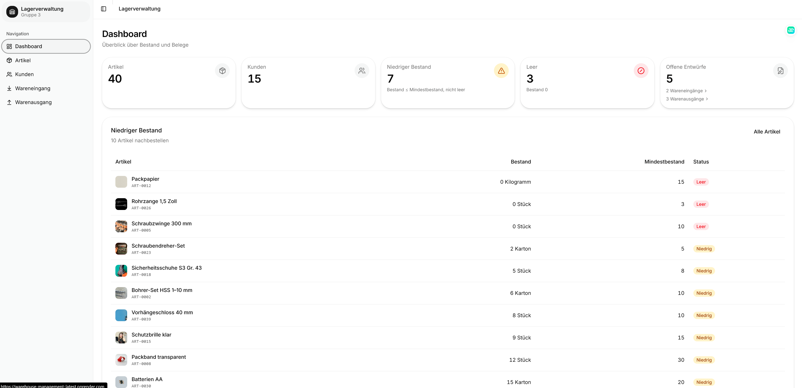
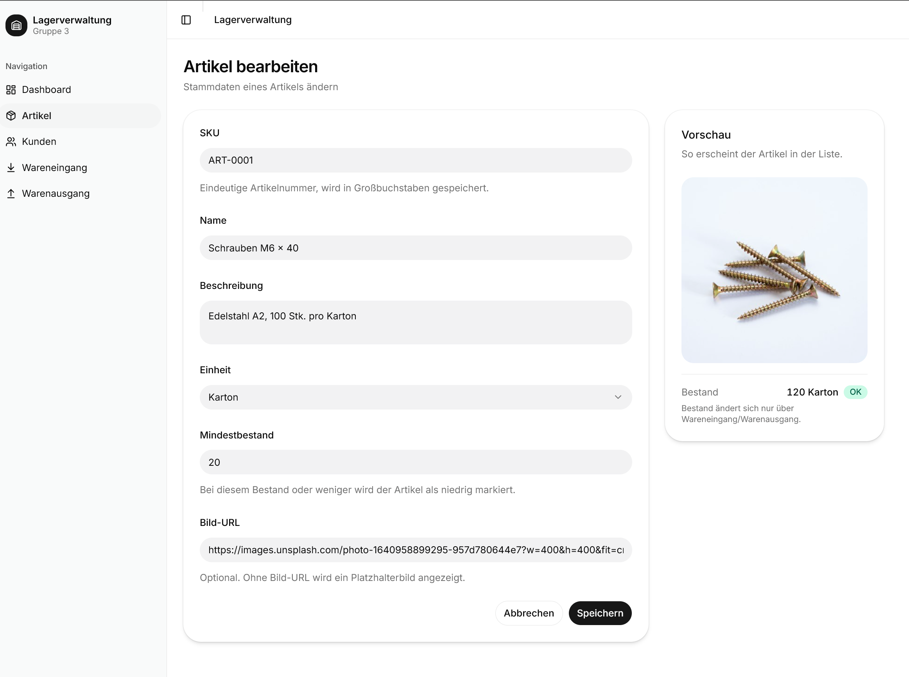
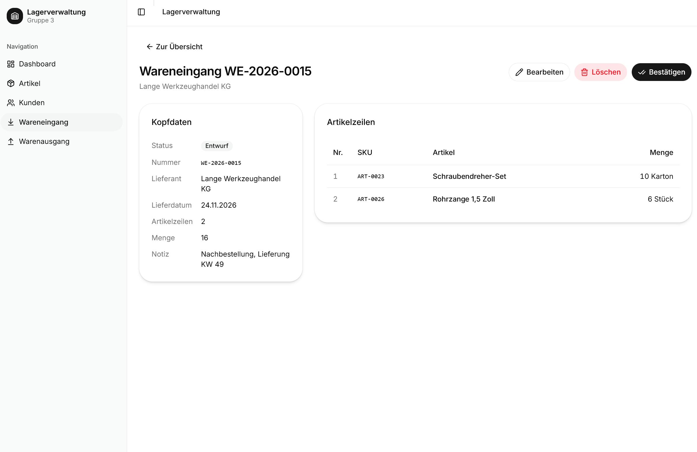
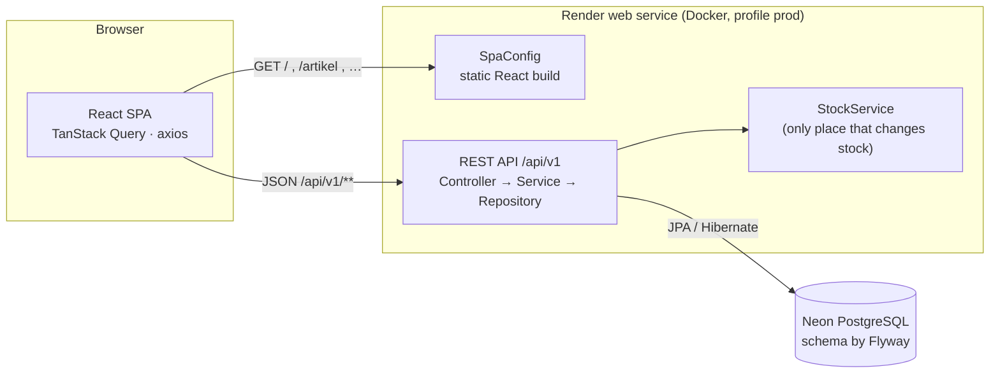
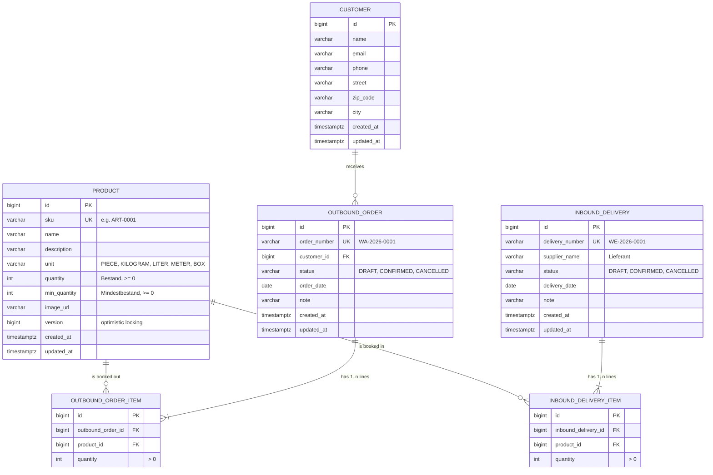
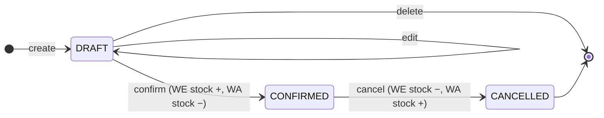
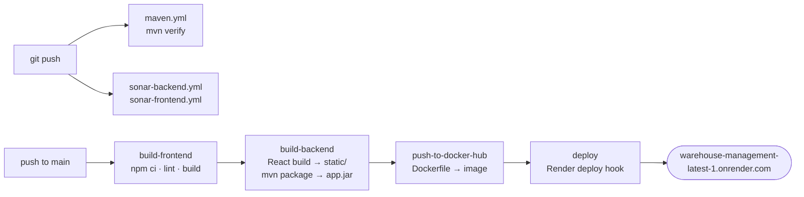

<div align="center">


# Warehouse Management · Lagerverwaltung

**Web app for warehouse stock management – Artikel, Kunden, Wareneingänge and Warenausgänge with automatic stock booking and low-stock warnings.**

[](https://warehouse-management-latest-1.onrender.com/)

[](https://github.com/Ramiismaeel/warehouse-management/actions/workflows/maven.yml)
[](https://github.com/Ramiismaeel/warehouse-management/actions/workflows/deploy.yml)
[](https://github.com/Ramiismaeel/warehouse-management/actions/workflows/sonar-backend.yml)
[](https://github.com/Ramiismaeel/warehouse-management/actions/workflows/sonar-frontend.yml)
[](https://sonarcloud.io/summary/new_code?id=ramiismaeel_warehouse-management_backend)
[](https://sonarcloud.io/summary/new_code?id=ramiismaeel_warehouse-management_frontend)

**Backend**


**Database**


-1E64B4)


**Frontend**


**Testing & quality**


**DevOps & tools**


</div>

---

## Table of contents

- [Live demo](#live-demo)
- [Screenshots](#screenshots)
- [Features](#features)
- [Architecture](#architecture)
- [Database](#database)
- [Business rules](#business-rules)
- [Project structure](#project-structure)
- [Getting started](#getting-started)
- [Profiles & configuration](#profiles--configuration)
- [API endpoints](#api-endpoints)
- [CI/CD & deployment](#cicd--deployment)
- [Testing & quality gates](#testing--quality-gates)
- [Team & workflow](#team--workflow)

---

## Live demo

👉 **https://warehouse-management-latest-1.onrender.com/**

The app runs on a free Render instance. After some idle time the first request wakes the service up, which can take
up to about a minute. The production database (Neon PostgreSQL) contains real data only, no seed data.

---

## Screenshots

**Dashboard** – KPIs, low-stock list and open drafts



| Edit an Artikel | Wareneingang detail (draft) |
|-----------------|-----------------------------|
|  |  |

---

## Features

- **Artikel (products)** – create, edit, delete, search by SKU or name, filter by stock (niedrig / leer); image with fallback; stock badge (OK / Niedrig / Leer)
- **Kunden (customers)** – full master data management with search
- **Wareneingang (goods in)** – drafts with any number of Artikelzeilen; *confirm* books stock **in**, *cancel* books it back **out**
- **Warenausgang (goods out)** – drafts per customer; *confirm* books stock **out**, *cancel* books it back **in**
- **Stock safety** – stock never goes negative; the whole operation is rejected and every shortage is listed
- **Dashboard** – number of Artikel and Kunden, low and empty stock, open drafts, latest documents
- **Document numbers** – generated by the backend, e.g. `WE-2026-0007` / `WA-2026-0012`
- **Concurrency** – optimistic locking on products (`@Version`), conflicts return a readable 409
- **German UI** – all texts in `src/i18n/de`, dates and numbers in `de-DE` format
- **API docs** – OpenAPI 3 with Swagger UI (local profiles; disabled in `prod` until login exists)

---

## Architecture



- **One jar, one image, one service:** the React build is copied into Spring Boot's `static/` folder. Frontend and API
  share the same origin, so there is no CORS and no extra web server. Unknown non-API paths fall back to `index.html`.
- **Backend:** package-by-feature (`product`, `customer`, `inbound`, `outbound`, `stock`, `document`, `dashboard`),
  layered inside each feature. DTOs are Java records, mapped with MapStruct. Errors are RFC 9457 `ProblemDetail`
  with German messages.
- **Frontend:** feature folders with `api.ts` → `queries.ts` (TanStack Query hooks) → pages/components. Forms use
  react-hook-form + zod, tables use TanStack Table, UI components come from shadcn/ui.

---

## Database



- A product appears at most once per document: `UNIQUE (document_id, product_id)` on both item tables.
- Foreign keys have **no cascade delete**. An Artikel or Kunde that is used in any document cannot be deleted (409).
- Schema sources: `db/migration/V1__init.sql` (Flyway, `prod`) and `schema.sql` (local). Both are kept in sync with
  the JPA entities; `prod` runs Hibernate with `ddl-auto=validate`.

| UI (German)   | Code                                   | Table                                        |
|---------------|----------------------------------------|----------------------------------------------|
| Artikel       | `Product`                              | `product`                                    |
| Kunde         | `Customer`                             | `customer`                                   |
| Wareneingang  | `InboundDelivery` / `InboundDeliveryItem` | `inbound_delivery` / `inbound_delivery_item` |
| Warenausgang  | `OutboundOrder` / `OutboundOrderItem`     | `outbound_order` / `outbound_order_item`     |
| Bestand / Mindestbestand | `Product.quantity` / `Product.minQuantity` | `quantity` / `min_quantity`    |

---

## Business rules



| Action  | Allowed when | Wareneingang          | Warenausgang          |
|---------|--------------|-----------------------|-----------------------|
| Create  | –            | new `DRAFT`, no stock | new `DRAFT`, no stock |
| Edit    | `DRAFT`      | no stock effect       | no stock effect       |
| Delete  | `DRAFT`      | no stock effect       | no stock effect       |
| Confirm | `DRAFT`      | stock **+**           | stock **−**           |
| Cancel  | `CONFIRMED`  | stock **−**           | stock **+**           |

1. `Product.quantity` is changed **only** by `StockService`. Create/update requests never contain a quantity.
2. Every stock decrease that would go below 0 rejects the **whole** operation (all-or-nothing) with a list of shortages.
3. Status change and stock change happen in **one** transaction.
4. Low stock: `quantity <= minQuantity` · out of stock: `quantity == 0`.
5. Duplicate products in one request are merged (quantities summed). A Warenausgang always has a customer.

---

## Project structure

```
warehouse-management/
├─ .github/
│  ├─ workflows/
│  │  ├─ maven.yml            CI: build + all backend tests on every push and PR
│  │  ├─ deploy.yml           CD: frontend → jar → Docker Hub → Render
│  │  ├─ sonar-backend.yml    SonarQube Cloud analysis (backend, JaCoCo coverage)
│  │  └─ sonar-frontend.yml   SonarQube Cloud analysis (frontend)
│  └─ pull_request_template.md
├─ docs/
│  ├─ PLAN.md                 plan, decisions, diagrams
│  ├─ TICKETS.md              all tickets (T01–T27, v1.1)
│  └─ images/                 screenshots for this README
├─ backend/                   Spring Boot 4 (Maven, Java 25)
│  ├─ pom.xml
│  └─ src/
│     ├─ main/java/training/backend/
│     │  ├─ BackendApplication.java
│     │  ├─ config/           CorsConfig, SpaConfig (serves the React build)
│     │  ├─ entities/         BaseEntity (id, createdAt, updatedAt)
│     │  ├─ exceptions/       GlobalExceptionHandler → ProblemDetail, domain exceptions
│     │  ├─ product/          Product, ProductUnit, Repository, Service, Controller, Mapper, dto/
│     │  ├─ customer/         same shape as product/
│     │  ├─ inbound/          InboundDelivery(Item), Repository, Service, Controller, Mapper, dto/
│     │  ├─ outbound/         OutboundOrder(Item), Repository, Service, Controller, Mapper, dto/
│     │  ├─ stock/            StockService – the only class that changes stock
│     │  ├─ document/         DocumentStatus, DocumentNumberGenerator
│     │  └─ dashboard/        DashboardService, DashboardController
│     ├─ main/resources/
│     │  ├─ application.properties          shared settings
│     │  ├─ application-{dev,postgres,prod}.properties
│     │  ├─ schema.sql                      DDL for local profiles
│     │  ├─ db/migration/V1__init.sql       Flyway (prod only)
│     │  └─ data/01…04-*.sql                demo data (dev)
│     └─ test/java/training/backend/        unit, MockMvc and @DataJpaTest tests
├─ frontend/                  React 19 + TypeScript + Vite
│  ├─ index.html
│  ├─ vite.config.ts          dev proxy /api → localhost:8080
│  ├─ components.json         shadcn/ui config
│  └─ src/
│     ├─ main.tsx             providers: QueryClient, Router, Toaster
│     ├─ router.tsx           all routes
│     ├─ index.css            Tailwind + shadcn theme
│     ├─ api/                 axios client (baseURL /api/v1), queryClient
│     ├─ components/
│     │  ├─ ui/               shadcn/ui components (generated)
│     │  ├─ layout/           AppLayout, AppSidebar, PageHeader, DocumentTitle, NotFoundPage, RouteErrorPage
│     │  └─ shared/           DataTable, ConfirmDialog, StatusBadge, StockBadge, ProductImage, DatePicker, EmptyState,
│     │                       UnsavedChangesGuard
│     ├─ features/
│     │  ├─ products/         api.ts, queries.ts, types.ts, schema.ts, pages/, components/
│     │  ├─ customers/        same shape
│     │  ├─ documents/        shared by inbound + outbound: DocumentItemsEditor, ProductPicker, DocumentActions, ShortageAlert
│     │  ├─ inbound/          same shape
│     │  ├─ outbound/         same shape
│     │  └─ dashboard/
│     ├─ hooks/               useApiErrorToast, useDebouncedValue, useIsMobile
│     ├─ i18n/de/             all German UI texts
│     └─ lib/                 cn(), de-DE formatting, ApiError, stock helpers, route id parsing
├─ Dockerfile                 eclipse-temurin:25-jre + app.jar
├─ compose.yaml               local PostgreSQL 18
├─ CLAUDE.md                  conventions for contributors and AI assistants
└─ README.md
```

### Frontend routes

| Path                                   | Page                         |
|----------------------------------------|------------------------------|
| `/`                                    | Dashboard                    |
| `/artikel` · `/artikel/neu` · `/artikel/:id/bearbeiten` | Artikel list / create / edit |
| `/kunden` · `/kunden/neu` · `/kunden/:id/bearbeiten`     | Kunden list / create / edit  |
| `/wareneingang` · `/wareneingang/neu` · `/wareneingang/:id` · `/wareneingang/:id/bearbeiten` | Wareneingang list / create / detail / edit |
| `/warenausgang` · `/warenausgang/neu` · `/warenausgang/:id` · `/warenausgang/:id/bearbeiten` | Warenausgang list / create / detail / edit |

---

## Getting started

### Prerequisites

- **Java 25** (e.g. Eclipse Temurin) – Maven comes with the wrapper
- **Node.js 22** + npm
- Optional: **Docker** for a local PostgreSQL (`compose.yaml`)

### 1. Backend

```bash
cd backend
./mvnw spring-boot:run          # Windows: mvnw.cmd spring-boot:run
```

Runs on http://localhost:8080 with profile `dev`: H2 in memory, demo data loaded on every start.

- Swagger UI: http://localhost:8080/swagger-ui.html
- OpenAPI JSON: http://localhost:8080/v3/api-docs
- H2 console: http://localhost:8080/h2-console · JDBC URL `jdbc:h2:mem:warehouse` · user `sa` · no password

### 2. Frontend

```bash
cd frontend
npm install
npm run dev
```

Open http://localhost:5173. Vite proxies `/api` to the backend on port 8080.

### Optional: local PostgreSQL

```bash
docker compose up -d                                                 # PostgreSQL 18 on 127.0.0.1:5432
cd backend
./mvnw spring-boot:run -Dspring-boot.run.profiles=postgres           # PowerShell: quote the -D argument
```

### Useful commands

| Where     | Command                  | Purpose                             |
|-----------|--------------------------|-------------------------------------|
| backend   | `./mvnw verify`          | compile + all tests + coverage      |
| backend   | `./mvnw test -Dtest=StockServiceTest` | run one test class     |
| frontend  | `npm run lint`           | ESLint                              |
| frontend  | `npm run build`          | type check (`tsc -b`) + production build |
| frontend  | `npm run format`         | Prettier (incl. Tailwind class sorting) |
| frontend  | `npx shadcn@latest add <name>` | add a shadcn/ui component     |

---

## Profiles & configuration

| Profile    | Database                     | Schema                          | Seed data |
|------------|------------------------------|---------------------------------|-----------|
| `dev` (default) | H2 in memory (PostgreSQL mode) | Hibernate `create-drop`      | yes, on every start |
| `postgres` | local PostgreSQL             | `schema.sql`, Hibernate validates | no      |
| `prod`     | Neon PostgreSQL              | Flyway, Hibernate validates     | no        |
| `test`     | H2                           | Hibernate                       | no        |

Configuration only through environment variables – no secrets in the repo or the image.

| Variable                 | Local                     | Production (Render)                  |
|--------------------------|---------------------------|--------------------------------------|
| `SPRING_PROFILES_ACTIVE` | `dev` (default)           | `prod`                               |
| `DB_URL`                 | `postgres` profile default | `jdbc:postgresql://<neon-host>/warehouse?sslmode=require&channelBinding=require` |
| `DB_USER`, `DB_PASSWORD` | `postgres` profile default | set in Render                        |
| `PORT`                   | `8080`                    | set by Render                        |

---

## API endpoints

Base path **`/api/v1`** · JSON in camelCase · dates as ISO `yyyy-MM-dd`. Full interactive docs in Swagger UI
(local profiles only).

### Artikel – `/api/v1/products`

| Method   | Path                     | Description                               | Success |
|----------|--------------------------|-------------------------------------------|---------|
| `GET`    | `/products?q=`           | List, optional search on SKU and name     | 200     |
| `GET`    | `/products/{id}`         | Detail                                    | 200     |
| `POST`   | `/products`              | Create (starts with quantity 0)           | 201     |
| `PUT`    | `/products/{id}`         | Update master data (never the quantity)   | 200     |
| `DELETE` | `/products/{id}`         | Delete – 409 if used in a document        | 204     |

### Kunden – `/api/v1/customers`

| Method   | Path                     | Description                               | Success |
|----------|--------------------------|-------------------------------------------|---------|
| `GET`    | `/customers?q=`          | List, optional search                     | 200     |
| `GET`    | `/customers/{id}`        | Detail                                    | 200     |
| `POST`   | `/customers`             | Create                                    | 201     |
| `PUT`    | `/customers/{id}`        | Update                                    | 200     |
| `DELETE` | `/customers/{id}`        | Delete – 409 if used in a Warenausgang    | 204     |

### Wareneingang – `/api/v1/inbound-deliveries`

| Method   | Path                                  | Description                          | Success |
|----------|---------------------------------------|--------------------------------------|---------|
| `GET`    | `/inbound-deliveries?status=`         | List, optional status filter         | 200     |
| `GET`    | `/inbound-deliveries/{id}`            | Detail with Artikelzeilen            | 200     |
| `POST`   | `/inbound-deliveries`                 | Create draft                         | 201     |
| `PUT`    | `/inbound-deliveries/{id}`            | Update draft (replaces lines)        | 200     |
| `DELETE` | `/inbound-deliveries/{id}`            | Delete draft                         | 204     |
| `POST`   | `/inbound-deliveries/{id}/confirm`    | `DRAFT → CONFIRMED`, stock **+**     | 200     |
| `POST`   | `/inbound-deliveries/{id}/cancel`     | `CONFIRMED → CANCELLED`, stock **−** | 200     |

### Warenausgang – `/api/v1/outbound-orders`

| Method   | Path                                  | Description                          | Success |
|----------|---------------------------------------|--------------------------------------|---------|
| `GET`    | `/outbound-orders?status=`            | List, optional status filter         | 200     |
| `GET`    | `/outbound-orders/{id}`               | Detail with Artikelzeilen            | 200     |
| `POST`   | `/outbound-orders`                    | Create draft                         | 201     |
| `PUT`    | `/outbound-orders/{id}`               | Update draft (replaces lines)        | 200     |
| `DELETE` | `/outbound-orders/{id}`               | Delete draft                         | 204     |
| `POST`   | `/outbound-orders/{id}/confirm`       | `DRAFT → CONFIRMED`, stock **−**     | 200     |
| `POST`   | `/outbound-orders/{id}/cancel`        | `CONFIRMED → CANCELLED`, stock **+** | 200     |

### Dashboard & operations

| Method | Path                  | Description                                          |
|--------|-----------------------|------------------------------------------------------|
| `GET`  | `/api/v1/dashboard`   | KPIs, low-stock list, latest Wareneingänge/-ausgänge |
| `GET`  | `/actuator/health`    | Health check (used by Render)                        |
| `GET`  | `/swagger-ui.html`    | Swagger UI (not in `prod`)                           |
| `GET`  | `/v3/api-docs`        | OpenAPI 3 document (not in `prod`)                   |

### Errors

All errors are RFC 9457 `ProblemDetail`. `detail` is a German message the frontend shows as-is.

| Status | When                                                                 |
|--------|----------------------------------------------------------------------|
| `400`  | validation failed – extra property `errors` (field → message)        |
| `404`  | resource not found                                                   |
| `409`  | duplicate SKU, record in use, wrong status, optimistic lock conflict, insufficient stock |

Example – confirming a Warenausgang without enough stock:

```json
{
  "status": 409,
  "title": "Nicht genügend Bestand",
  "detail": "Nicht genügend Bestand für „Versandkarton 600x400x400“: benötigt 40, verfügbar 0.",
  "instance": "/api/v1/outbound-orders/8/confirm",
  "shortages": [
    { "productId": 6, "sku": "ART-0006", "name": "Versandkarton 600x400x400", "requested": 40, "available": 0 }
  ]
}
```

---

## CI/CD & deployment



| Workflow             | Trigger                                  | What it does                                                         |
|----------------------|------------------------------------------|----------------------------------------------------------------------|
| `maven.yml`          | every push and pull request              | Java 25, `mvn -B verify` – compile, unit and integration tests        |
| `sonar-backend.yml`  | push to `main` / `release/v1.1`, PRs     | tests + JaCoCo coverage, analysis on SonarQube Cloud                 |
| `sonar-frontend.yml` | push to `main` / `release/v1.1` (frontend changes) | static analysis of `frontend/src` on SonarQube Cloud        |
| `deploy.yml`         | push to `main`, manual *Run workflow*    | `build-frontend` → `build-backend` → `push-to-docker-hub` → `deploy` |

**How the deployment works**

1. The frontend is built (`npm run build`) and copied into `backend/src/main/resources/static/`.
2. Maven builds one jar (`app.jar`) that serves both the React app and the API; the tests run here too.
3. The root `Dockerfile` (`eclipse-temurin:25-jre`, runs as a non-root user, `SPRING_PROFILES_ACTIVE=prod` by default)
   wraps the jar into an image, which is pushed to Docker Hub.
4. The Render deploy hook pulls the new image. Render runs it with profile `prod` against Neon PostgreSQL; Flyway
   migrates the schema on startup.

**Secrets** (GitHub → Settings → Secrets): `DOCKERHUB_USERNAME`, `DOCKERHUB_PASSWORD` (access token),
`DOCKERHUB_TAG`, `RENDER_DEPLOY_HOOK`, `SONAR_TOKEN`, optional `RENDER_DEPLOY_HOOK_URL_2` (second Render service,
skipped when not set). Database credentials are only set in Render.

**Manual redeploy:** GitHub → Actions → *deploy* → *Run workflow*.

---

## Testing & quality gates

- **Backend:** JUnit 5, Mockito and MockMvc – unit tests for `StockService` and every status transition
  (success and rejection), MockMvc tests for validation / 404 / 409 per controller, `@DataJpaTest` for custom queries.
  Test names describe the behavior, e.g. `confirm_whenStockInsufficient_rejectsAndChangesNothing`.
- **Frontend:** manual test steps in every PR.

Must be green before every pull request:

```bash
cd backend  && ./mvnw verify
cd frontend && npm run lint && npm run build
```

---

## Team & workflow

- **Team:** Gruppe 3 – 3 developers
- **Tickets:** Jira (`WM-…`), described in [`docs/TICKETS.md`](docs/TICKETS.md) · plan and decisions in [`docs/PLAN.md`](docs/PLAN.md)
- **Branches:** `feature/WM-<n>-<short-desc>` from `main` · one ticket = one branch = one PR
- **Commits:** `WM-12: add product list page` · PRs are squash-merged after at least one approval
- **Conventions:** see [`CLAUDE.md`](CLAUDE.md) (glossary, layer rules, business rules, API conventions)
