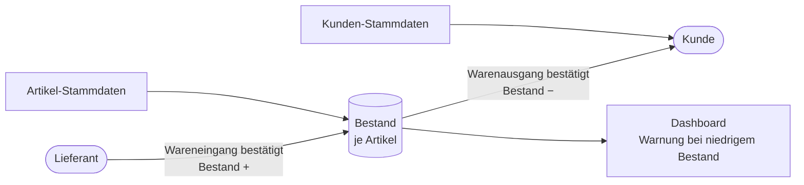
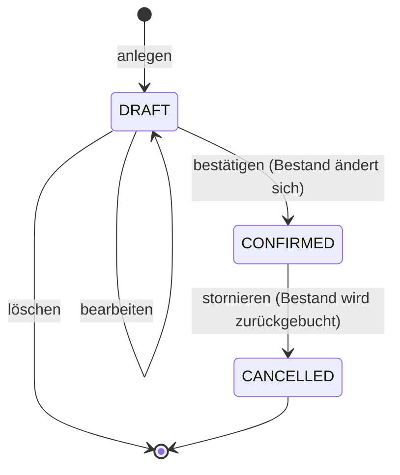
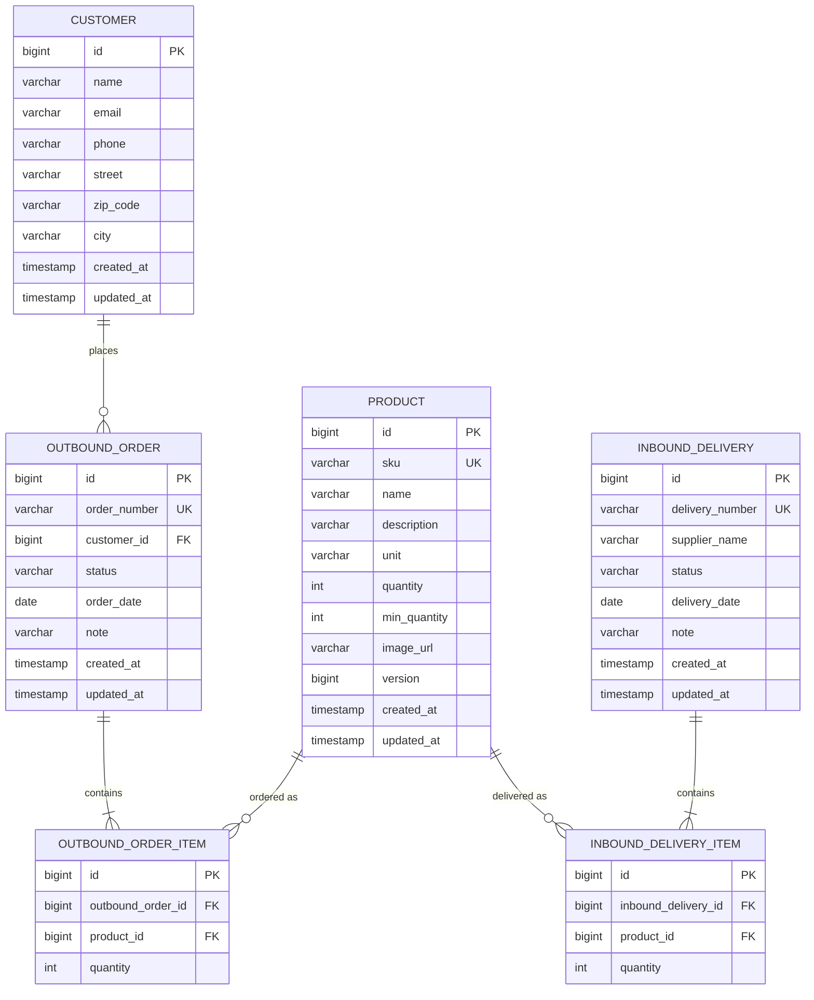
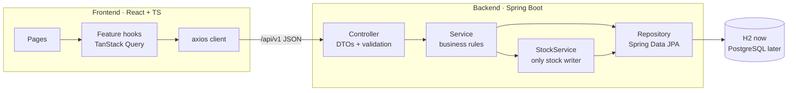
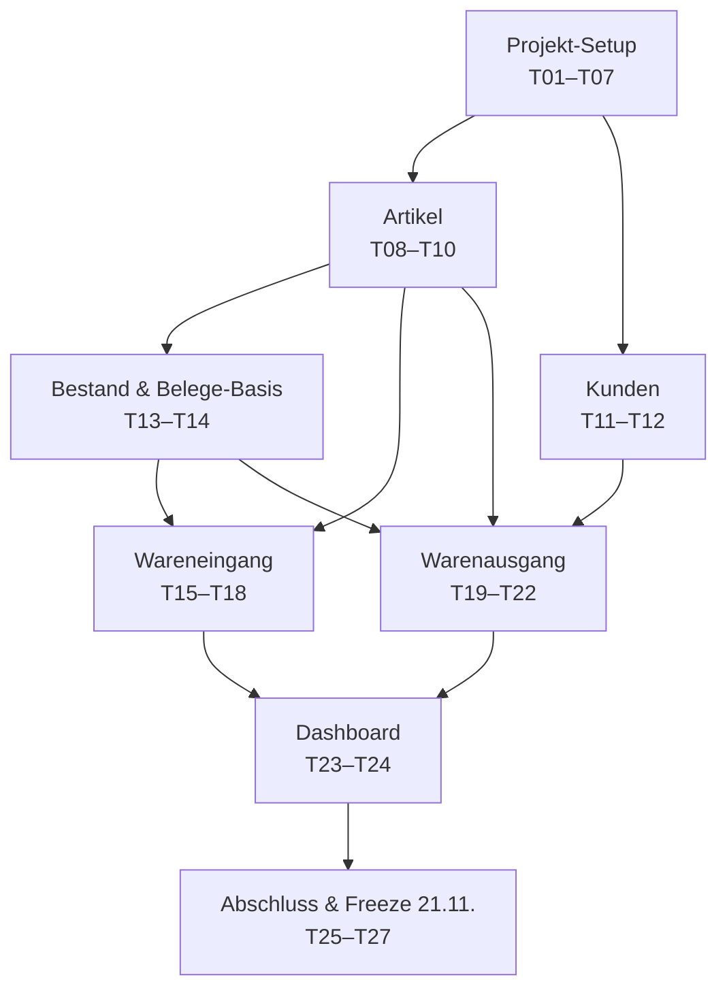

# Projektplan – Warehouse Management (Gruppe 3)

> Wissen Sie nie, wie hoch Ihr Bestand noch ist? Unsere Anwendung ermöglicht es Ihnen, digital den Überblick
> über Ihre Waren zu behalten. Legen Sie neue Artikel an, erstellen Sie Wareneingänge und Warenausgänge,
> welche den Bestand automatisch anpassen.

| | |
|---|---|
| Team | 3 developers |
| Start | Do 12.11.2026 |
| Feature freeze | Sa 21.11.2026 |
| Deadline / presentation | Mo 23.11.2026 |
| Conventions for code & Claude | [`CLAUDE.md`](../CLAUDE.md) |
| All tickets in detail | [`TICKETS.md`](TICKETS.md) · Jira import: [`jira-import.csv`](jira-import.csv) |

---

## 1. What the app does

Every Wareneingang and Warenausgang (a *Beleg*) goes through the same status flow. Stock changes only on
**confirm** and is reversed on **cancel**:

UI labels: `DRAFT` = Entwurf · `CONFIRMED` = Bestätigt · `CANCELLED` = Storniert.

---

## 2. Decisions (locked)

| # | Topic | Decision |
|---|-------|----------|
| 1 | Meaning of the two documents | Wareneingang = goods from supplier, stock ↑ · Warenausgang = goods to customer, stock ↓ |
| 2 | When stock changes | Status flow: on confirm, reversed on cancel |
| 3 | Stock storage | `quantity` field on the article (no movement history) |
| 4 | Entities in MVP | Artikel, Kunde, Wareneingang, Warenausgang (+ items). Supplier = free-text name |
| 5 | UI components | shadcn/ui |
| 6 | Repo layout | Monorepo (`/backend`, `/frontend`) |
| 7 | Backend structure | Package-by-feature, layered inside |
| 8 | Build tool | Maven |
| 9 | Schema | Hibernate `ddl-auto` now, Postgres-ready (profiles, portable SQL), Flyway when switching |
| 10 | Data fetching | axios + TanStack Query |
| 11 | UI language | German only (texts in one place) |
| 12 | Process | 3 people, tickets without sprints, branch `feature/WM-<n>-<desc>`, ≥ 1 reviewer, no direct push to `main` |
| 13 | Code naming | `InboundDelivery` / `OutboundOrder` |
| 14 | Supplier | Free-text `supplierName` on Wareneingang |
| 15 | Deleting used Artikel/Kunde | Blocked with a 409 message |

**Defaults set during planning (change via team decision):** base package `de.gruppe3.warehouse` ·
new articles start with Bestand 0, stock changes only through documents · squash merge · lists without server
paging · H2 in-memory (data resets on restart) · Jira project key `WM`.

---

## 3. Glossary

| UI (German) | Code | Direction |
|---|---|---|
| Artikel | `Product` | – |
| Kunde | `Customer` | – |
| Wareneingang | `InboundDelivery` (+ `InboundDeliveryItem`) | IN, stock ↑ |
| Warenausgang | `OutboundOrder` (+ `OutboundOrderItem`) | OUT, stock ↓ |
| Bestand / Mindestbestand | `quantity` / `minQuantity` | – |

Full glossary and all business rules: [`CLAUDE.md`](../CLAUDE.md#domain-glossary-use-exactly-these-names).

---

## 4. Data model

Relations in words: a Kunde has many Warenausgänge · each Beleg has ≥ 1 item · each item points to one Artikel ·
Wareneingang has **no** direct relation to Artikel or Warenausgang.

---

## 5. Architecture overview

Folder structures, layer rules and API endpoints: [`CLAUDE.md`](../CLAUDE.md#backend-architecture).

---

## 6. Feature dependencies & team lanes

| Lane | Person | Tickets | Focus |
|------|--------|---------|-------|
| 1 | Person 1 | T02, T03, T08, T09, T10, T15, T16, T17, T18 | Backend setup → Artikel → Wareneingang |
| 2 | Person 2 | T04, T05, T11, T12, T19, T20, T21, T22 | Frontend setup → Kunden → Warenausgang |
| 3 | Person 3 | T01, T06, T07*, T13, T14, T23, T24, T25, T26, T27 | Repo, shared components, stock logic → Dashboard, demo, freeze |

\* T07 (CI) is optional. Lanes are a suggestion: rebalance freely, but keep one owner per ticket.

---

## 7. Timeline

| Day | Person 1 | Person 2 | Person 3 |
|-----|----------|----------|----------|
| Do 12.11. | T02 BE scaffold | T04 FE scaffold | T01 Repo & workflow |
| Fr 13.11. | T03 BE common | T05 FE app shell | T06 Shared UI (start) |
| Sa–So 14.–15.11. | *buffer* | *buffer* | *buffer* |
| Mo 16.11. | T08 BE Artikel API | T11 BE Kunden API | T06 finish, T07 CI (optional) |
| Di 17.11. | T09 + T10 FE Artikel | T12 FE Kunden | T13 StockService |
| Mi 18.11. | T15 BE Wareneingang drafts | T19 BE Warenausgang drafts | T14 FE document components |
| Do 19.11. | T16 BE WE confirm/cancel | T20 BE WA confirm/cancel | T23 BE Dashboard, T25 Delete protection |
| Fr 20.11. | T17 + T18 FE Wareneingang | T21 + T22 FE Warenausgang | T24 FE Dashboard, T26 Demo data |
| **Sa 21.11.** | **Feature freeze** – T27 README & smoke test | | |
| So–Mo 22.–23.11. | Bugfixes, presentation | | |

**Merge order matters on day 1–2:** T01 first (repo exists) → T02 and T04 in parallel → T03 and T05.
Everyone pulls `main` after these are merged.

---

## 8. Recommended libraries

| Need | Library | Why |
|------|---------|-----|
| UI components | shadcn/ui | Tailwind-native, accessible (Radix), code lives in the repo |
| Icons | lucide-react | Default for shadcn, consistent, tree-shakable |
| Font | Inter via `@fontsource-variable/inter` | Self-hosted, works offline and in Docker |
| Product images | Lorem Picsum `picsum.photos/seed/<sku>/400/400` | Stable random image per SKU |
| Tables | `@tanstack/react-table` | Used by the shadcn data-table pattern |
| Forms | react-hook-form + zod | shadcn form components are built on them |
| Toasts | sonner | shadcn default |
| API docs | springdoc-openapi | Swagger UI for free |

---

## 9. Later (prepared, not built)

| Topic | What's already prepared |
|-------|-------------------------|
| PostgreSQL | `prod` profile, PostgreSQL driver, H2 in Postgres mode, portable seed SQL, no reserved table names |
| Flyway | Schema is stable and documented in section 4; add `V1__init.sql` when switching |
| Docker | Config via env vars, backend and frontend start independently |
| Security | Versioned API under `/api/v1`, entities never exposed, central exception handling |
| CI/CD | T07 adds the PR checks; deployment can build on it |
| History | A stock movement table can be added inside `StockService` without touching features |
